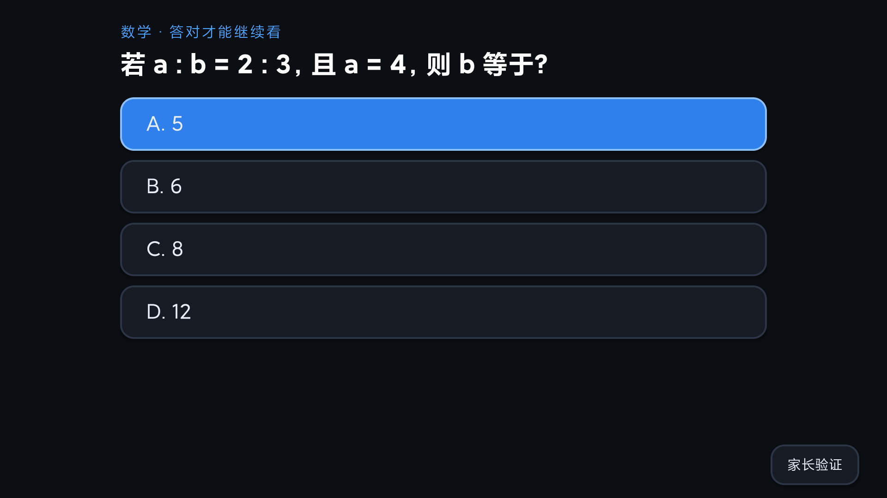
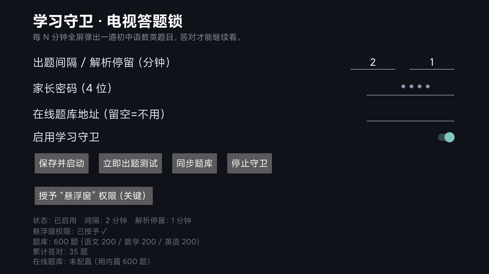
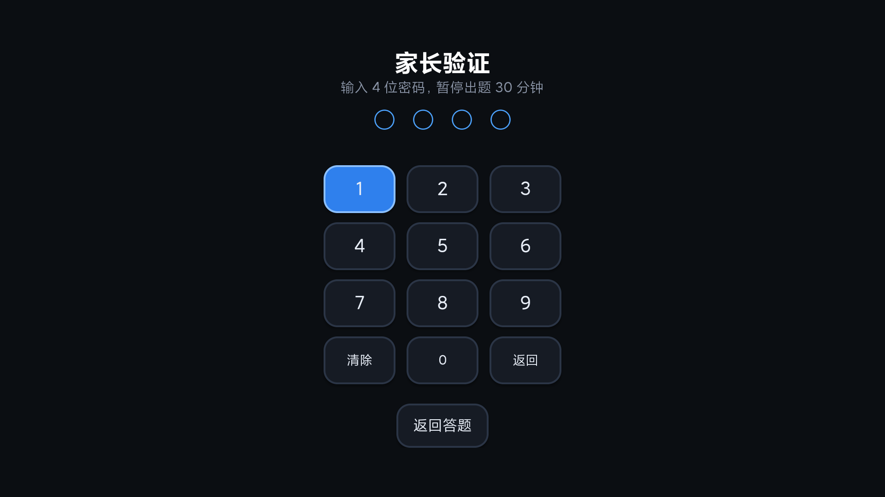
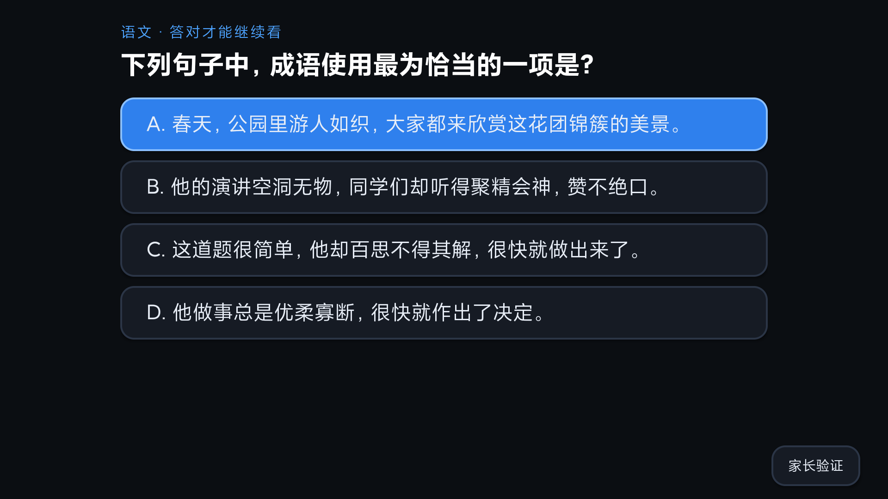
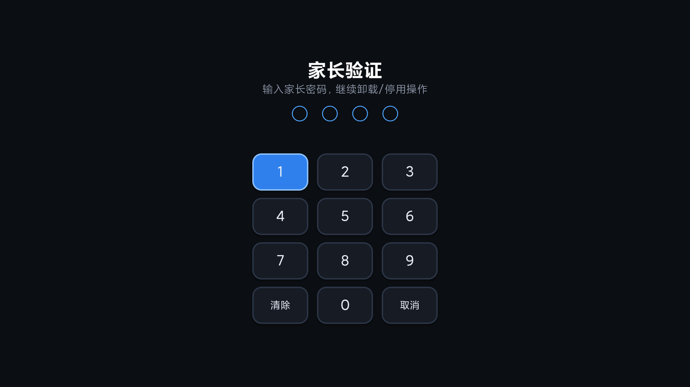
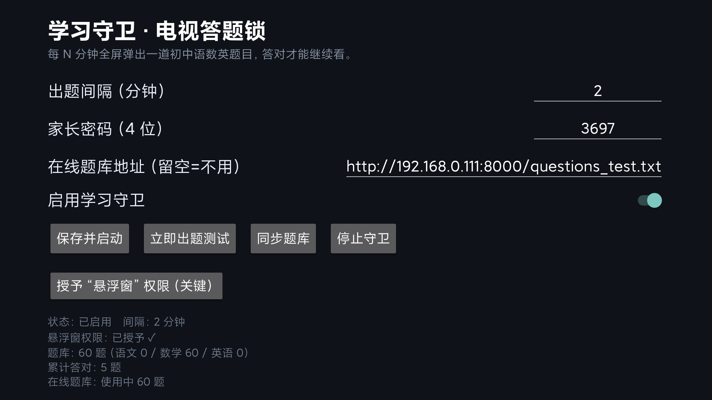

# 学习守卫 · 电视答题锁

给家里的电视加一道"答题闸门"：看着看着全屏弹一道初中题，**答对还不够，得把解析读完倒计时结束才放行**。
顺手把小米电视的开机广告也关掉。

一个 81KB 的 APK，纯 Java、无原生库、无 Google 依赖，Android 5.0+ 的电视都能装。



## 功能

- **到点弹题**：间隔可设（默认 1 分钟），全屏盖住画面，遥控器返回/菜单键被吃掉
- **答对≠通过**：答对后强制进入"解析阅读"，显示正确答案原文 + 解析 + 倒计时（默认 1 分钟），读完才放行
- **答错不放水**：错项变灰、提示排除法，可以一直试，但不会自己解锁
- **自动静音**：弹题瞬间静音 + 抢音频焦点，绝大多数播放器会自动暂停
- **家长密码**：答题页右下角「家长验证」，输密码可暂停 30 分钟 / 卸载放行，连错 3 次锁定
- **防卸载**：设备管理器 + 无障碍拦截，卸载/停用要输家长密码
- **题库 600 题**：语文/数学/英语各 200，中考难度，每题带解析；支持**在线题库**热更新
- **开机自启**：开机广播 + 前台服务（能否生效取决于电视品牌，见下文实测）

## 快速开始

不需要 Android Studio，也不需要 Gradle —— 只要有 JDK 和 Android SDK（build-tools + platforms）：

```bash
./build.sh                                   # 打包，产物在 out/StudyGuard.apk
DEVICE=192.168.1.50 ./scripts/install.sh     # 装到电视（电视需先开网络调试）
```

> 改题库：编辑 `questions_src/*.txt` → `python3 scripts/build_questions.py` → 重新 `./build.sh`

---

## 一、实测机型

| 项目 | 值 |
| --- | --- |
| 型号 | `MiTV-NSOP0`（平台 `furyroad`） |
| 系统 | Android 9（SDK 28），MIUI TV 1365 |
| 屏幕 | 1920×1080，density 320（1dp = 2px） |
| 桌面 | `com.mitv.tvhome` 3.50.1621 |

---

## 二、开机广告（已关闭）

### 2.1 它是谁放的（三条证据）

1. `logcat` 里有 `com.mitv.tvhome.BootActivity.sendAdShowBroadcast`。
2. 桌面进程请求 `api.ad.xiaomi.com/ott/fetchAds?...&appKey=OTT_POWER_SERVICE` —— `OTT_POWER_SERVICE` 就是开机广告位。
3. 桌面 APK 里有 `com.mitv.tvhome.ads.bootad.BootAdPresenter`、`ads.screenad.BootScreenAdManger`、`BootAdDialog`，读的键是 `boot_ad_switch`。

结论：广告是**系统桌面自己播的**，跟 `com.miui.systemAdSolution` 无关。

### 2.2 已执行

```bash
adb shell settings put system boot_ad_switch 0     # 原值 null（默认开）
```

* 脚本：`./scripts/ads.sh off` / `on` / `status`
* 原值备份：`out/ad-backup.txt`
* 生效时机：真正关机再开机

### 2.3 复发兜底

系统升级可能重置该键：重跑 `./scripts/ads.sh off`，或在路由器 DNS 屏蔽
`api.ad.xiaomi.com`、`ad.xiaomi.com`。

---

## 三、答题锁 App（学习守卫）

### 3.1 安装

```bash
./scripts/install.sh
```

### 3.2 设置页



* **出题间隔**：默认 **1 分钟**（1~120 可调）
* **解析停留**：默认 **1 分钟**（0~10 可调），答对后强制看解析的时长
* **家长密码**：默认 `1234` —— **第一次用务必改掉**
* **启用开关**：默认开
* **立即出题测试**：马上弹一道

### 3.3 密码在哪里改

电视上打开「学习守卫」，第二行就是 **家长密码（4 位）**：

1. 用遥控器把焦点移到密码输入框
2. 按 OK 调出输入法，改成你自己的 4 位数字
3. 点「保存并启动」

也可以在电脑上用一条命令改：

```bash
adb shell am start -n com.family.studyguard/.MainActivity -e cmd set -e pin 5678
```

### 3.4 到点后会发生什么

1. 全屏盖住画面（悬浮窗压在所有 App 之上，桌面也盖得住）
2. 同时**静音 + 抢占音频焦点**，播放器自动暂停
3. 遥控器方向键选答案、OK 确认；**返回键/菜单键被吃掉**
4. 答错 → 选项变灰 + 提示，继续答，**不会自己解锁**
5. 答对 → **进入"解析阅读"**：显示正确答案 + 解析 + 倒计时，**读完倒计时才放行**；
   期间视频持续暂停、返回键无效，防止"蒙对就跑"。家长可用「家长验证」提前结束。
6. 家长放行：右下角「家长验证」→ 输密码 → 暂停 30 分钟（连错 3 次本次锁定）

| 答对后的解析阅读 | 家长验证 |
| --- | --- |
|  |  |

> 为什么要有这一段：孩子靠排除法或运气蒙对，选择题本身证明不了"会了"。
> 强制停留 1~2 分钟，把"看解析"这一步压实。设成 0 则恢复成 2.4 秒放行。

### 3.5 题库

**600 题：语文 200 / 数学 200 / 英语 200**，中考难度偏上，每题带解析。



为保证正确性做了两轮：先三科各生成 200 题，再由三个独立"审题老师"逐题复核——
数学用 sympy 机器复核约 150 个可算项；英语消掉了 5 处"两个选项都能填"的双解；
语文修了 31 题（含 12 道排序题连待排句子都没给的硬伤、以及"解析和答案对不上"的错位）。

* 题目放在 `app/assets/questions.txt`，一行一题：
  ```
  科目|题干|A|B|C|D|正确序号0-3|解析
  ```
* 三科原始题库在 `questions_src/`，改完跑 `python3 scripts/build_questions.py` 合并
  （自动校验字段、去重、打乱选项让答案分布均匀）
* 再 `./build.sh && ./scripts/install.sh`

### 3.6 实现原理

| 文件 | 作用 |
| --- | --- |
| `GuardService.java` | 前台服务，每 5 秒轮询是否到点（抗待机休眠） |
| `QuizOverlay.java` | `TYPE_APPLICATION_OVERLAY` 悬浮窗，可获焦、吃掉按键 |
| `QuizScreen.java` | 答题 UI、家长密码键盘、错项排除 |
| `QuestionBank.java` | 从 assets 读取并解析题库 |
| `MediaPauser.java` | 静音 + 音频焦点抢占 |
| `BootReceiver.java` | 开机自启（见第四节，系统会拦） |
| `GuardAdmin.java` | 设备管理器，防卸载第一层 |
| `GuardAccessibilityService.java` | 拦截卸载/停用弹窗，改要家长密码 |
| `PinGateActivity.java` | 家长密码闸门 |

---

## 四、开机自启：该机型做不到（已实测两种方案）

MIUI 在开机时会把第三方 App 全部 `force-stop`，实测证据：

```
D/PackageManager: stop: com.family.studyguard for user 0
```

此时 `stopped=true`，`BOOT_COMPLETED` 不会投递（重启后实测：服务数 0、进程 0）。

试过并**失败**的两条路：
1. `BOOT_COMPLETED` + `LOCKED_BOOT_COMPLETED` 静态广播 —— 被 stopped 状态过滤
2. 挂一个 `TvInputService`（系统开机时会把电视输入源全部绑定一遍，想借此拉起进程）—— 实测也没被拉起

网上同类讨论的结论也是[不 root 无解](https://www.znds.com/tv-1266763-1-1.html)。

**所以现实是：**

| 场景 | 守卫状态 |
| --- | --- |
| 遥控器关机（待机）→ 再开机 | ✅ 服务一直在，照常每分钟弹题 |
| 彻底断电 / 重启电视 | ⚠️ 点一下桌面上的「学习守卫」图标，或电脑上跑 `./scripts/start-guard.sh` |

日常使用基本是待机，所以影响很小；孩子要是学会了重启电视，这套方案挡不住
（要彻底堵死只能 root 后改系统，不推荐）。

---

## 五、防卸载（孩子删不掉）

默认情况下这个 App 是能被直接卸载的。现在加了两层保护：



1. **设备管理器**（`GuardAdmin`）：在系统里登记为设备管理员，多一道"取消激活"的门槛。
2. **无障碍拦截**（`GuardAccessibilityService`）：盯着系统弹窗，一旦出现
   "卸载 学习守卫"或"取消激活设备管理"，立刻**自动按返回取消**，并弹出家长验证。

   连错 3 次 → 本次直接拦截；输对密码 → **放行 5 分钟**，这时可以正常卸载/停用。

实测：`am start -a android.intent.action.UNINSTALL_PACKAGE` 触发的卸载对话框被成功拦截，
输对密码后 5 分钟内对话框正常出现。

注意：**打开"应用详情"页也会被拦**——因为那个页面本身就带"卸载"按钮，属于同一类入口。

**家长自己要卸载**（两条路）：

```bash
./scripts/uninstall.sh          # 一条命令清干净：停服务 + 取消管理员 + 关无障碍 + 卸载
```

或者在电视上触发卸载 → 输家长密码 → 5 分钟内点"卸载"。

**这套保护的边界（如实说）**：

* 谁要是会用 adb，`adb uninstall` 是拦不住的（你电脑上就能做到）
* `am force-stop` 会顺带把无障碍拦截暂时关掉，重启 App 即恢复（电视上到不了这个入口）
* 如果有人能在系统设置里关掉无障碍服务，拦截就失效（该机型设置里没找到无障碍入口）
* 设备所有者（不可卸载级别）需要清空小米账号才能设置，代价太大，没做

## 六、在线题库（可选，已实现）

**先说结论：本地题库没有"装不下"的问题**——600 题才 119KB，就算做到 1 万题也就 2MB，
该机型 25GB 空闲。真正值得联网的理由是：**改题不用重新打包、不用连电脑重装**。



### 怎么用

1. 把 `questions.txt` 放到任意电视能访问的地址（局域网 HTTP 也行，公网建议 HTTPS）
2. 电视设置页填「在线题库地址」→ 点「同步题库」
3. 状态显示「在线题库：使用中 N 题」就生效了

电脑上一条命令也行：

```bash
adb shell am start -n com.family.studyguard/.MainActivity -e cmd remote -e url http://192.168.1.50:8000/questions.txt
```

本地快速起个服务测试：`./scripts/serve_bank.sh`（会打印出该填的地址）。

### 规则（防呆）

* **至少 50 题**才接受，格式错的行自动跳过
* 同步失败/断网 → **自动回退内置 600 题**，绝不会出现"没题可出"
* 服务启动时每天最多自动同步一次
* 清空地址 = 回到内置题库：`adb shell am start -n com.family.studyguard/.MainActivity -e cmd remote-clear`

### 托管建议

| 方式 | 说明 |
| --- | --- |
| 局域网 NAS / 树莓派 | 最稳，不依赖公网 |
| 阿里云 OSS / 腾讯云 COS | 便宜、稳定，HTTPS |
| GitHub raw | 免费，但国内访问可能慢 |
| Gitee raw | 国内快，需仓库公开 |

## 七、其他限制

* 卸载已被拦（见第五节），但懂 adb 的人仍可直接卸载
* 待机时 ADB 断线是正常现象，按一下电源键就回来

## 八、安全提醒

5555（网络调试）现在对整个局域网敞开。折腾完建议关掉：
**设置 → 开发者选项 → 网络调试 / USB 调试**。

## 九、装到别的电视上

APK 是**纯 Java、无原生库、无 Google 依赖**（81KB，minSdk 21 / targetSdk 28），
任何 Android 5.0+ 的电视/盒子/投影都能装。

### 能不能装

| 设备 | 结论 |
| --- | --- |
| 小米 / Redmi 电视 | ✅ 本机已验证 |
| 索尼、飞利浦、松下、夏普（Android TV 版） | ✅ |
| TCL / 雷鸟、海信（Android TV 版）、创维 / 酷开、长虹、康佳、海尔 | ✅ |
| 当贝 / 极米 / 坚果等 Android 投影、NVIDIA Shield | ✅ |
| 华为智慧屏（HarmonyOS） | ❌ 不跑 Android APK |
| 三星（Tizen）、LG（webOS）、Roku、海信 VIDAA 机型 | ❌ 非 Android 系统 |

### 每台都要做的 4 步

1. 电视开「开发者选项 → USB/网络调试」（或直接用 U 盘装 APK）
2. `DEVICE=<新电视IP> ./scripts/install.sh`
3. 授予**悬浮窗权限**（各家叫法不同："悬浮窗" / "显示在其他应用上层" / "后台弹出界面"）
4. 打开 App 设置**家长密码**和间隔

### 换品牌最容易踩的坑

| 坑 | 说明 |
| --- | --- |
| 悬浮窗权限 | 名字各家不同，部分 ROM 还有单独的"后台弹出界面"开关 |
| 无障碍入口 | 有的电视设置里没有，直接 `adb shell settings put secure enabled_accessibility_services com.family.studyguard/.GuardAccessibilityService` |
| 开机自启 | 策略各不相同；小米禁，多数品牌允许（换机器可能反而能用） |
| 桌面找不到图标 | 去"我的应用 / 全部应用"里翻，本 APK 没做图标，可能显示默认安卓图标 |
| 遥控器 OK 键 | 已兼容 `DPAD_CENTER` 和 `ENTER` 两种 |

> 注：防卸载拦截已做**中英文双语**关键字匹配（"卸载/uninstall"），英文系统的电视也能拦。

## 十、构建与改动指南

| 想改什么 | 改哪里 |
| --- | --- |
| 题库 | `questions_src/语文.txt` 等三个文件，跑 `scripts/build_questions.py` 合并 |
| 出题/答题 UI | `app/src/com/family/studyguard/QuizScreen.java` |
| 计时与放行逻辑 | `GuardService.java` |
| 悬浮窗 | `QuizOverlay.java` |
| 静音/暂停 | `MediaPauser.java` |
| 防卸载 | `GuardAdmin.java` + `GuardAccessibilityService.java` |
| 在线题库同步 | `RemoteBank.java` |
| 小米开机广告 | `scripts/ads.sh` |

打包流程：`build.sh` 依次调用 `aapt2 compile` → `javac` → `d8` → `aapt2 link` → `zipalign` → `apksigner`，
不依赖 Gradle，产物约 81KB。

## 十一、免责声明

- 本项目用于**自己家里**的电视（家长控制），请勿用于控制他人设备。
- 修改系统设置（如关闭开机广告）属于对自有设备的调整，请自行承担风险。
- 小米电视的系统更新可能重置相关设置，重新执行即可。

## 十二、目录

```
tv-change/
├── build.sh                     # 不用 Gradle：aapt2 + javac + d8 + apksigner
├── app/                         # App 源码 + assets/questions.txt
├── questions_src/               # 三科原始题库（语文/数学/英语各 200 题）
├── out/StudyGuard.apk           # 成品
├── docs/img/                    # 电视实拍截图
└── scripts/
    ├── ads.sh                   # 开机广告开关 off/on/status
    ├── install.sh               # 安装 + 授权 + 启动
    ├── build_questions.py       # 三科题库合并 + 校验 + 打乱选项
    ├── start-guard.sh           # 重启电视后一键拉起守卫
    ├── uninstall.sh             # 家长彻底卸载（清管理员/无障碍）
    ├── serve_bank.sh            # 本机临时起题库服务（测试在线题库）
    └── boot-trace.sh            # 开机取证
```
